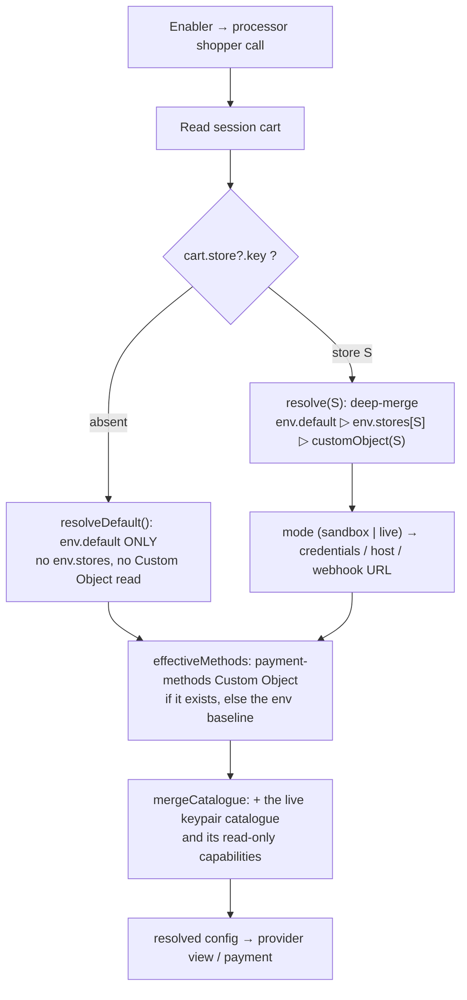

# Payment Integration Processor
This module provides an application based on [commercetools Connect](https://docs.commercetools.com/connect), which is triggered by HTTP requests from Checkout UI for payment operations.

The corresponding payment, cart or order details would be fetched from composable commerce platform, and then be sent to external PSPs for various payment operations such as create/capture/cancel/refund payment.

The module carries the two commercetools Connect lifecycle scripts, both wired in `connect.yaml`: `postDeploy` registers the connector's commercetools artifacts and validates the deployment, and `preUndeploy` is deliberately empty, so an undeploy deletes nothing. What each one writes, and what survives an undeploy, is described with the scripts themselves.

## Getting Started

These instructions will get you up and running on your local machine for development and testing purposes.
Please run following npm commands under `processor` folder.

#### Install PSP SDK
In case SDK is provided by payment service provider for communication purpose, you can import the SDK by following commands
```
$ npm install <psp-sdk>
```
#### Install dependencies
```
$ npm install
```
#### Build the application in local environment. NodeJS source codes are then generated under dist folder
```
$ npm run build
```
#### Run automation test
```
$ npm run test
```
#### Run the application in local environment. Remind that the application has been built before it runs
```
$ npm run start
```
#### Fix the code style
```
$ npm run lint:fix
```
#### Verify the code style
```
$ npm run lint
```
#### Run post-deploy script in local environment
Runs the encryption-key rotation and nothing else: it re-encrypts the stored store-config secrets under `ENCRYPTION_KEY` and re-registers the webhooks whose token that key derives (both no-ops without `ENCRYPTION_KEY_PREVIOUS`). The payment custom type and the eight `PaymentState` states are provisioned by saving a store connection instead. Idempotent, so it is safe to re-run. It executes the compiled `dist/`, so build first.
```
$ npm run build && npm run connector:post-deploy
```
#### Run pre-undeploy script in local environment
Deliberately does nothing: `preUndeploy()` has an empty body, so the command exits 0 with no output and issues no commercetools and no Unzer request. Nothing the connector registered is removed, and the Unzer webhook subscription is removed by the store disconnect (`DELETE /operations/store-config`) instead. It executes the compiled `dist/`, so build first.
```
$ npm run build && npm run connector:pre-undeploy
```

## Running application

Setup correct environment variables: check `processor/src/infrastructure/config/config.ts` for default values.

Make sure commercetools client credential have at least the following permissions:

* `manage_payments`
* `manage_checkout_payment_intents`
* `view_sessions`
* `introspect_oauth_tokens`
* `view_stores` (store-existence authorization + the store-list / reference-data reads on the `/operations` config endpoints)
* `view_project_settings` (reference-data languages/currencies/countries on `/operations/store-reference-data`)

```
npm run dev
```

## Authentication

Some of the services have authentication mechanism. 

* `oauth2`: Relies on commercetools OAuth2 server
* `session`: Relies on commercetools session service
* `jwt`: Relies on the jwt token injected by the merchant center via the forward-to proxy

### OAuth2
OAuth2 token can be obtained from commercetools OAuth2 server. It requires API Client created beforehand. For details, please refer to [Requesting an access token using the Composable Commerce OAuth 2.0 service](https://docs.commercetools.com/api/authorization#requesting-an-access-token-using-the-composable-commerce-oauth-20-service).

### Session
Payment connectors relies on session to be able to share information between `enabler` and `processor`.
To create session before sharing information between these two modules, please execute following request to commercetools session service
```
POST https://session.<region>.commercetools.com/<commercetools-project-key>/sessions
Authorization: Bearer <oauth token with manage_sessions scope>

{
  "cart": {
    "cartRef": {
      "id": "<cart-id>" 
    }
  },
  "metadata": {
    "allowedPaymentMethods": ["card", "ideal", ...],
    "paymentInterface"?: "<payment interface that will be set on payment method info https://docs.commercetools.com/api/projects/payments#ctp:api:type:PaymentMethodInfo>"
  }
}
```

Afterwards, session ID can be obtained from response, which is necessary to be put as `x-session-id` inside request header when sending request to endpoints such as `/operations/config` and `/operations/payments`.

### JSON web token (JWT)

The merchant `/operations/*` routes are authenticated by a **real** Merchant Center JWT. There
is **no JWT mock**: the JWKS and issuer the processor validates against are derived from
`CTP_REGION` and always point at the real `mc-api.<region>.commercetools.com`, and cannot be
pointed elsewhere. A valid bearer is only an exchange token the MC API Gateway forward-to proxy
(`/proxy/forward-to`) mints for this processor. To exercise these routes locally, authenticate
through that proxy and send the exchange token as
`Authorization: Bearer <token>`.

## Store & configuration resolution

The processor is **multi-store**: one deployment serves every store in the project. The
shopper flow (`GET /operations/config`, `POST /payments`, `POST /operations/transactions`)
resolves its store **from the session cart** (`cart.store?.key`) —
not from a deployment-wide key.

- **Cart names store `S`** → `resolveStoreConfig(S)` deep-merges two layers, highest wins:
  `customObject(__default__) ▷ customObject(S)`, both Merchant-Center-saved. Then the active
  environment — the envelope-level `mode`, `sandbox` or `live`, defaulting to `sandbox` —
  selects credentials / host / webhook URL.
- **Cart names no store** → `resolveDefault()` reads the `__default__` scope **only**, never a
  per-store override.
- **`GET /return`** resolves the store from the payment's stamped `storeKey` custom field,
  so return-token verification runs against the credentials the payment was created with.

`resolveStoreKey()` is the commercetools **project key** only. It is the fallback for the
merchant `X-Store-Key` **read** routes, the store-authorization "trusted own store" check, and
the post-deploy rotation; the shopper flow derives its store from the cart instead.

The webhook receiver scopes its store by the route path: `POST /webhooks/:storeKey/:token`. The
**`token` segment is what admits the delivery** — a per-store capability token derived from
`ENCRYPTION_KEY`, compared constant-time and fail-closed before any commercetools or vendor I/O.
The route carries no session or OAuth preHandler, so the store key alone admits nothing: a wrong
token is answered `401` before any store data is read, and a URL with no token segment matches no
route at all (`404`).

> **The project key is RESERVED.**
> A config **write** must NAME a real store: a `PUT`/`DELETE /operations/store-config` whose target
> resolves to the project key — an explicit `X-Store-Key == projectKey` or an absent header — is
> rejected **400**. So no config can exist under the project key, and a no-store payment's later legs
> (`resolve(projectKey)`) resolve exactly what its create leg did (`resolveDefault()`) — a payment can
> never be authorized on one PSP account and captured on another. Deployment-wide defaults go in the
> `__default__` scope, which every store with no connection of its own inherits.
> No back-compat shim is provided (repo policy).

**What a store offers, per environment.** The resolved `settings` document carries no behavior — the
provider's schema is strict and rejects every field, so the document is empty. What a store offers is
the per-environment `PaymentMethodConfig` list, which comes from one source: the payment-methods
Custom Object, written only by the MC config app. It **governs wholesale** (`effectiveMethods`),
across both environment sets. An environment the object does not configure therefore has no methods,
and an empty list in it is a merchant statement, not an absence.

That effective list is merged with the live keypair's method catalogue (`mergeCatalogue`): each
catalogue entry takes the persisted config if present, else a disabled default, plus the vendor's
read-only capabilities (`supportsAuthorize` / `supportsCharge`, `vendorCountries` /
`vendorCurrencies`). A persisted method absent from the catalogue is dropped. Per-method
`amountLimits` and `countries` are what restrict a method to a market.


